<p align="center">
  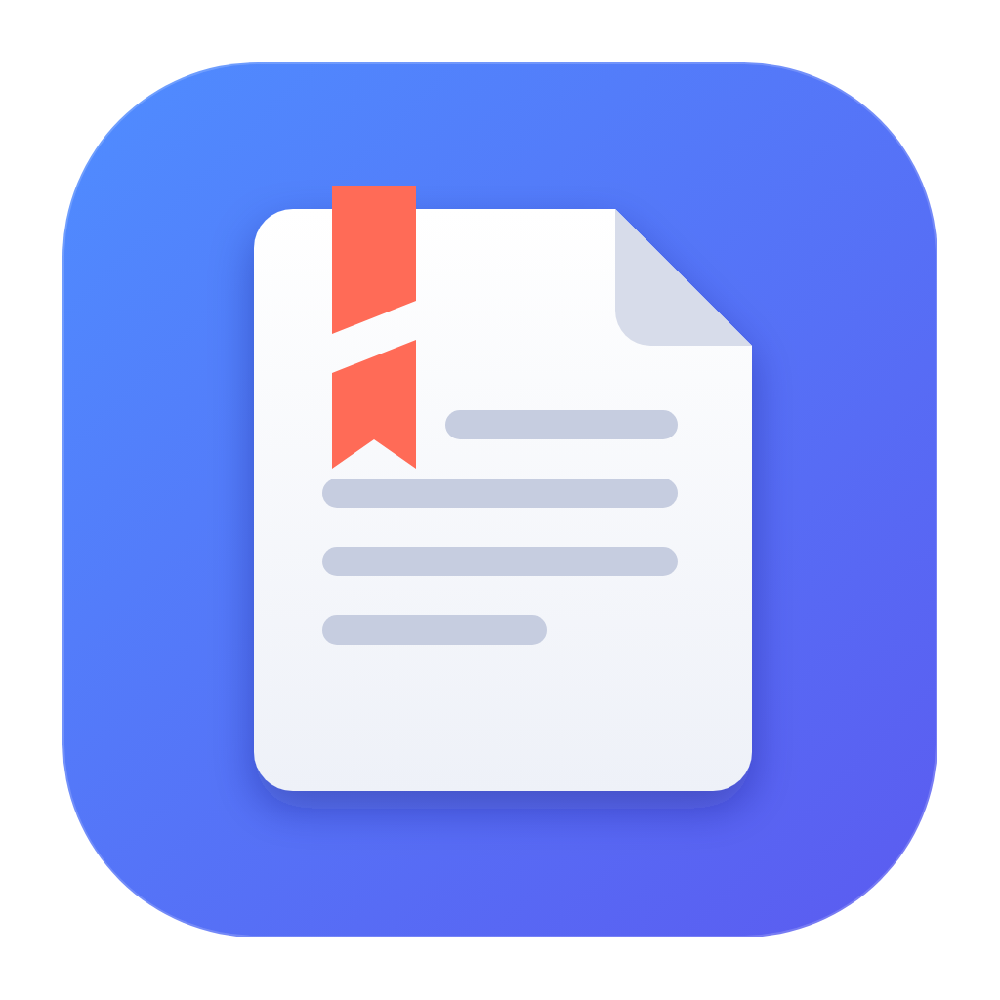
</p>

<h1 align="center">Ribbonless</h1>

<p align="center"><b>Word files, without the ribbon. Or the subscription.</b><br>
A small, free editor for <code>.docx</code> documents on Windows.</p>

<p align="center">
  <a href="https://github.com/stefanrotari99i/ribbonless/releases/latest"><b>Download for Windows</b></a> (2.2 MB)
</p>

<p align="center">
  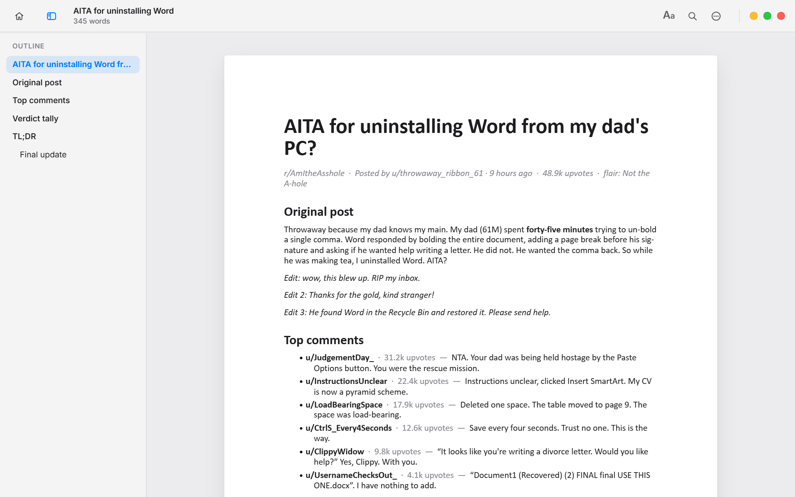
</p>

## Why I made this

Ok so. Someone emails me a `.docx`. I need to fix one typo and send it back. That's it. That's the whole job.

And somehow that turned into: open Word, wait, get told my subscription expired, get offered Copilot, close three
popups, finally find the text under a ribbon with 47 buttons I've never clicked in my life, fix the typo, and watch
Word quietly move my image to page 4 as a thank you.

I'm sorry but paying every month just to _open a file_ is insane. Nobody pays a subscription to look at a JPEG.

So I built the thing I actually wanted. You open a Word file, it shows up in about half a second, you edit it, it
saves. The file comes out as a normal `.docx` that Word, Google Docs and LibreOffice open fine, and it only rewrites
the paragraphs you touched, so it won't wreck the rest of your document. No account. No ads. No "sign in to continue".
Nothing gets uploaded anywhere. The installer is 2.2 MB, which is less than the Word splash screen probably weighs.

It does the stuff normal people actually do: writing, headings, bold and friends, lists, tables, images, links, find
and replace, spell check, and going back to an older version when you mess up. It does _not_ do mail merge, SmartArt or
whatever "Text Effects and Typography" is. If you need those, Word is right there, enjoy.

Free, open source, MIT. It stays that way.

## A quick tour

The document in these screenshots is a made-up Reddit thread (`scripts/make-sample.mjs`). If it feels personal,
that's between you and your ribbon.

### Start screen

Templates for a letter, report, meeting notes and design doc, plus the documents you opened recently.
`Ctrl+N` starts a blank one, `Ctrl+O` opens a file, and you can also drop a `.docx` onto the window.
The house button in the corner (or `Alt+Home`) brings you back here at any time; your open documents stay in their
tabs, one click away.

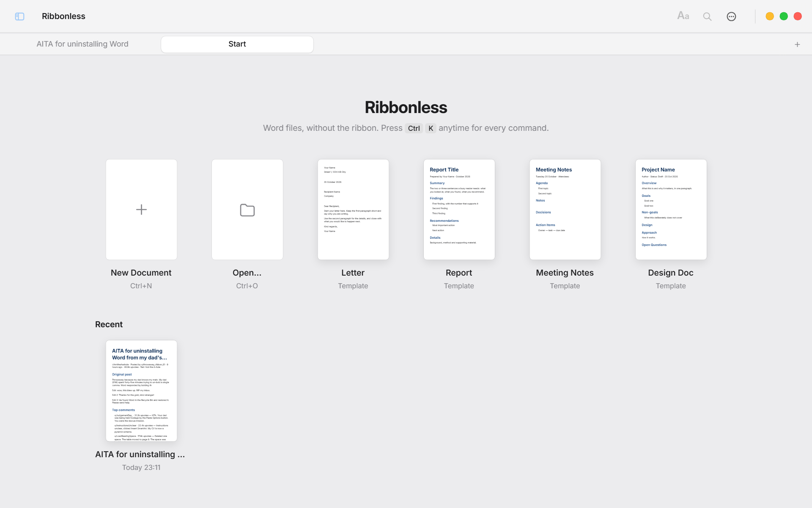

### Formatting, all in one panel

The **Aa** button opens styles (title, headings, body), bold, italic, underline, font size and font, line spacing,
space after paragraphs, text color (including any custom color), highlight, alignment and lists.
Shown here in the dark appearance; the page itself stays white, like paper.

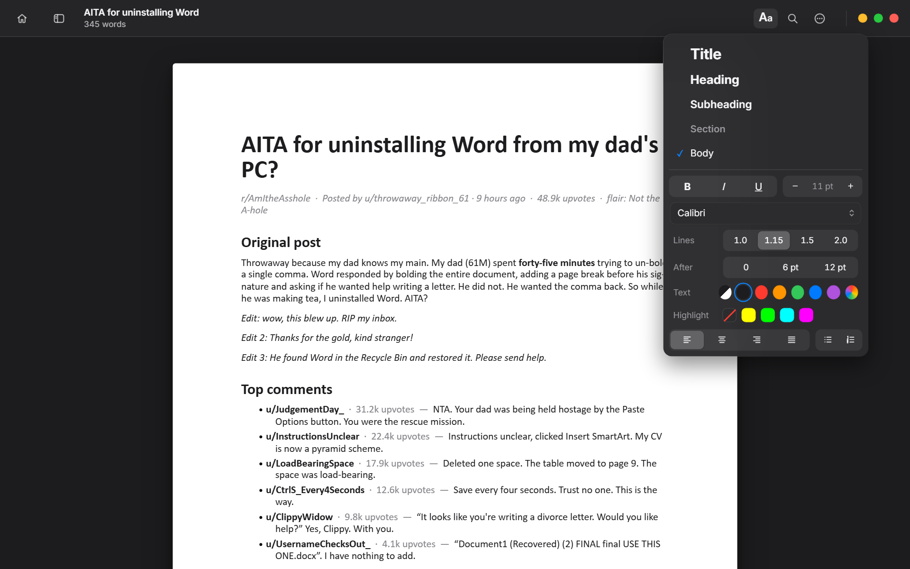

### Selection bar

Select some text and the common actions float above it: bold, italic, underline, link, highlight, headings and lists.

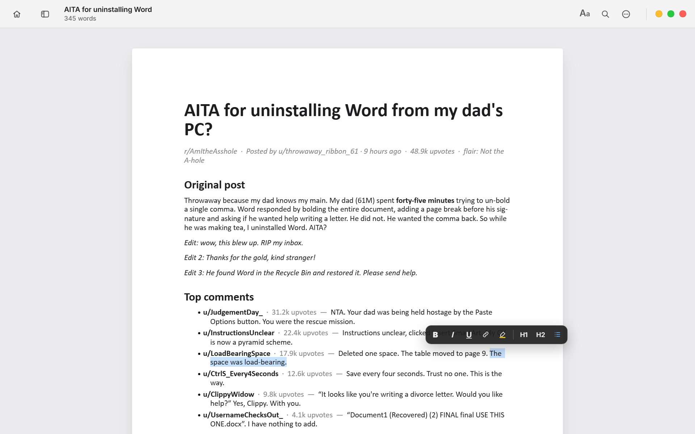

### Command bar

`Ctrl+K` finds any command by typing a few letters: insert, export, templates, line spacing, version history,
jump to a heading. You never have to remember where something lives.

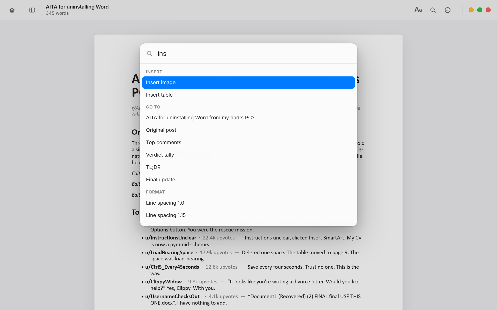

### Slash menu and Markdown shortcuts

Type `/` on an empty line to turn it into a heading, list, table or image. Markdown works while you type too:
`# ` for a heading, `- ` for a bullet, `1. ` for a numbered list, `**bold**` and `*italic*`.
Everything is saved as real Word styles, not as Markdown.

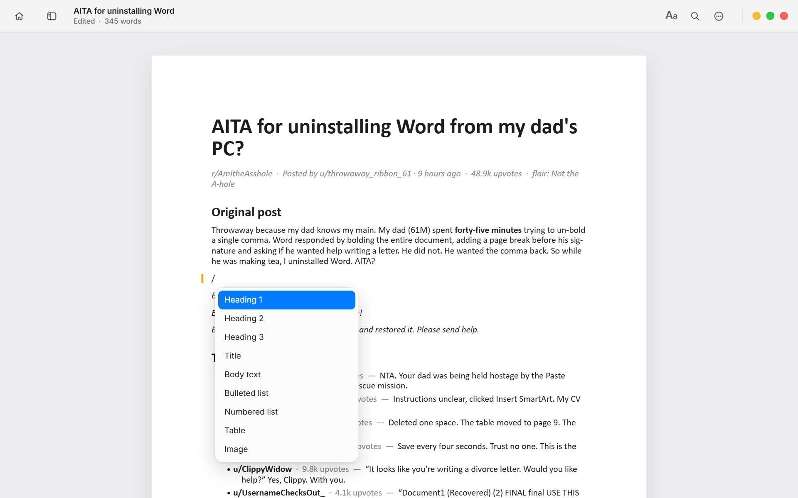

### Find and replace

`Ctrl+F` to find, `Ctrl+H` to replace. Matches are highlighted as you type; **All** replaces every match in one
step, and one `Ctrl+Z` undoes it.

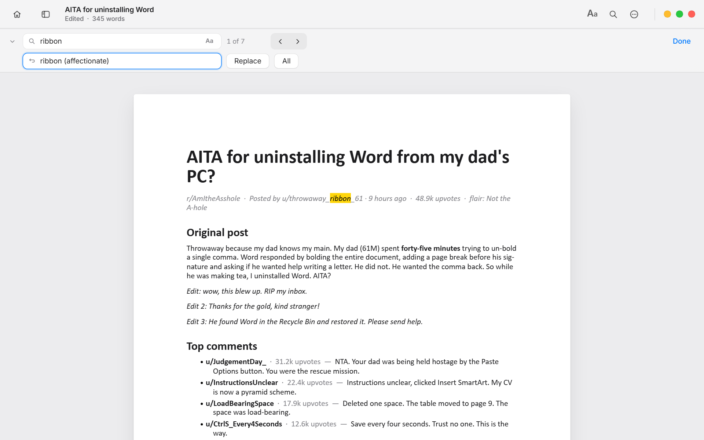

### Tables

Insert a table from the `/` menu. Tab moves to the next cell and adds a row at the end; right-click a cell to insert
or delete rows and columns, or the whole table.

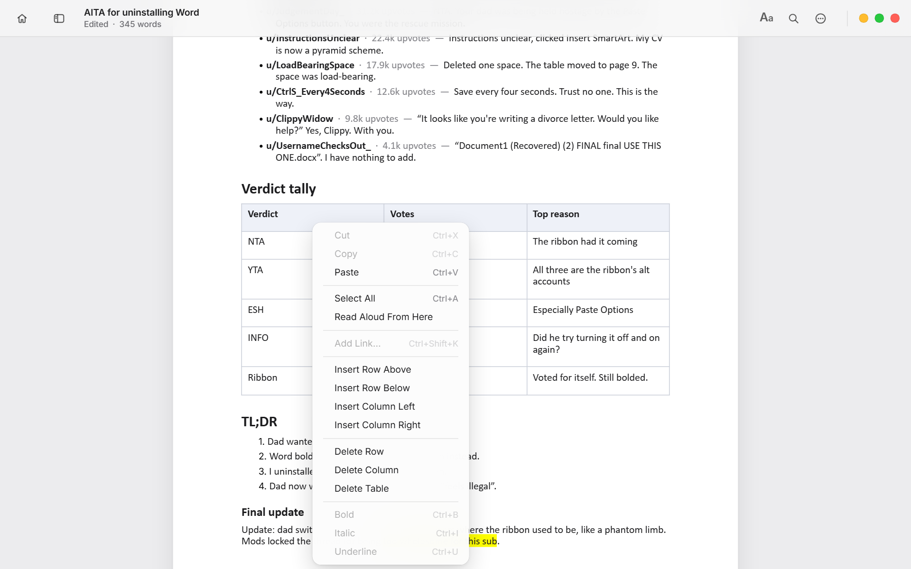

### Links

Select text and press `Ctrl+Shift+K`. Links are saved as normal Word hyperlinks. `Ctrl+click` opens them in your browser.

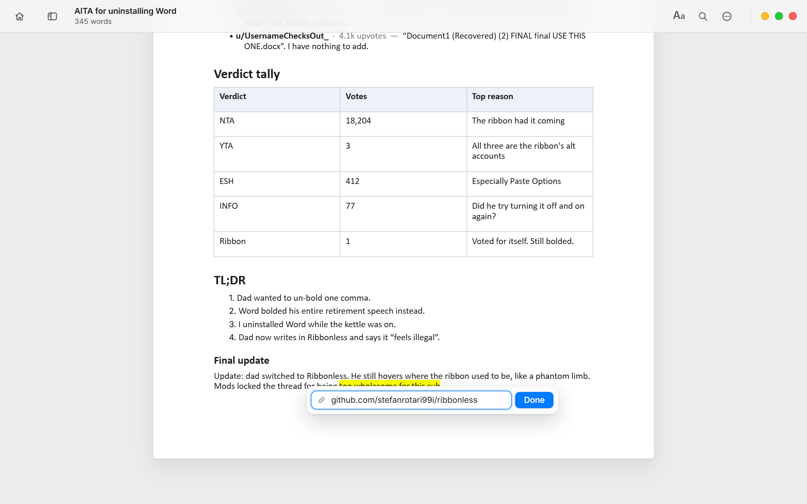

### Spelling

Misspelled words are underlined using the Windows spellchecker, in whatever languages you have installed.
Right-click for suggestions or to add the word to your dictionary.

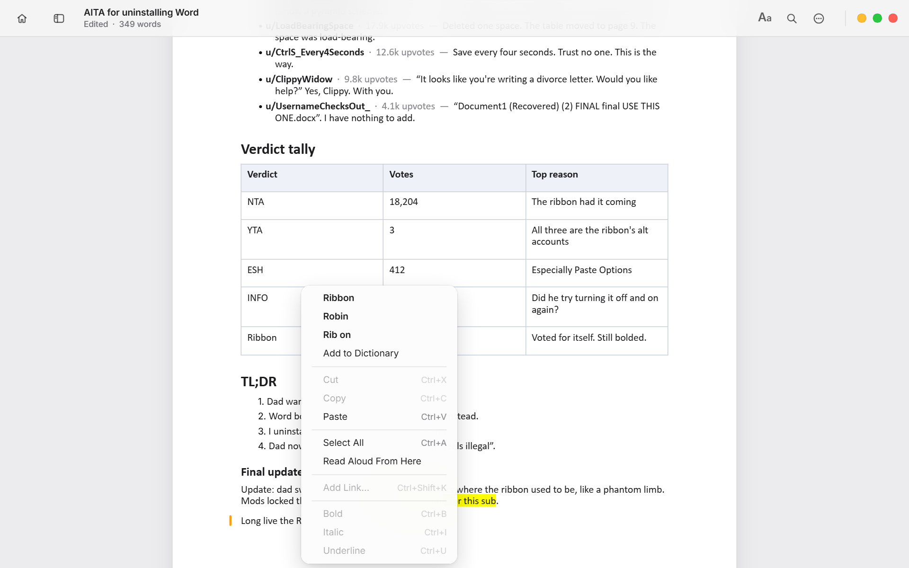

### Changes since you opened the file

A thin mark in the margin shows every paragraph you changed in this session, so you can see at a glance what you touched.

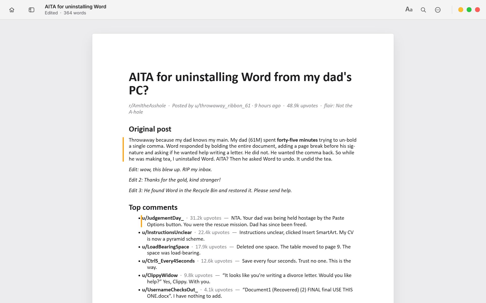

### Version history

Ribbonless keeps earlier versions of each document on your computer. Open **⋯ → Version history**, click a version to
see it exactly as it was, and restore it if you want it back. Nothing is lost when you restore: the text being replaced
is kept as a version too.

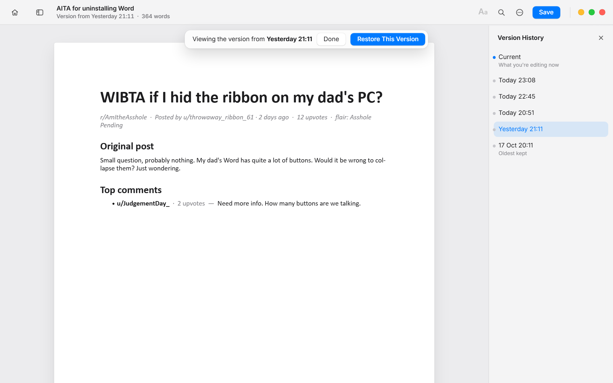

### Images

Insert, paste or drag in images. Click one to resize it from the corners, align it, or delete it.
Images are stored inside the `.docx`, like Word does.

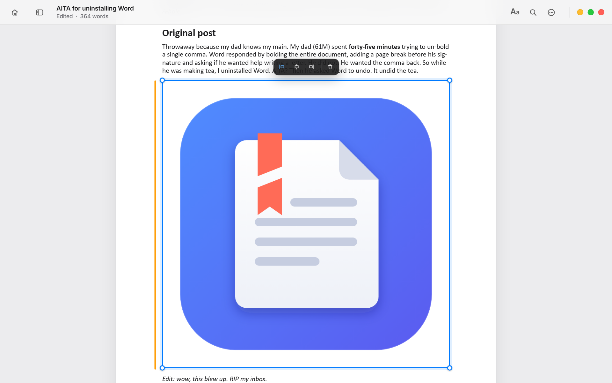

### Focus mode

`Ctrl+Shift+F` hides everything except the page and dims all paragraphs but the one you're writing.

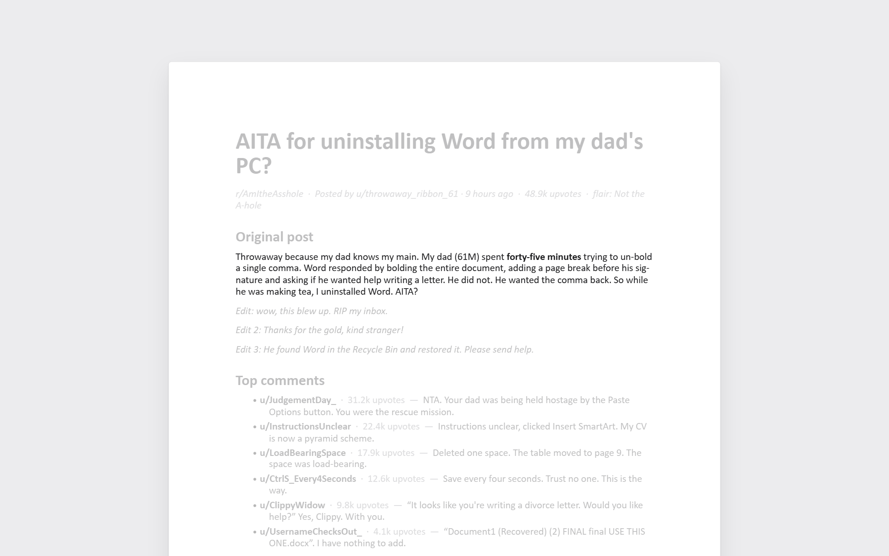

### Tabs

`Ctrl+T` opens a new tab; each tab keeps its own document, undo history and scroll position. Ribbonless reopens
your tabs next time.

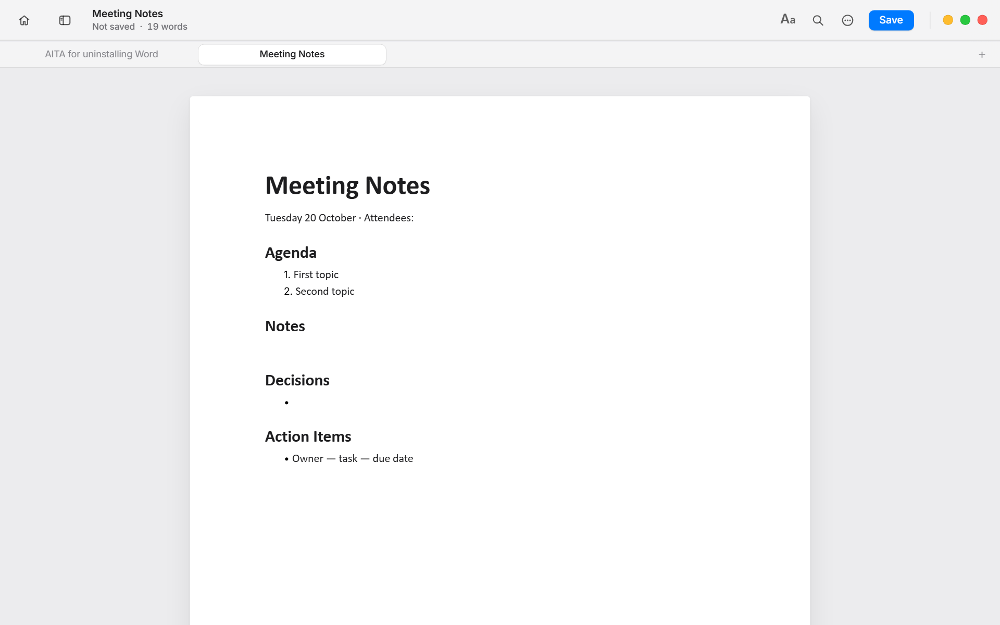

### Also

- Outline sidebar (`Ctrl+Shift+O`) built from the headings, shown in the first screenshot
- Read aloud from any paragraph, with the spoken word highlighted
- Export to PDF (`Ctrl+P`), Markdown or a self-contained HTML page
- A word count goal, light and dark appearance, and the frosted Windows 11 window background

### Not losing work

- Auto-save to the file, plus a backup for documents that were never saved
- Saving writes a temporary file first and then swaps it in, so a crash mid-save never leaves a broken document

## Install

Download the latest installer from [Releases](https://github.com/stefanrotari99i/ribbonless/releases) and run it.
Windows 10 and 11 are supported; the frosted window background needs Windows 11.

The installer is not code-signed yet, so Windows SmartScreen may warn the first time. Choose **More info → Run anyway**,
or build it yourself from source (below) if you prefer.

## Privacy and security

- Nothing leaves your computer. There are no accounts, no telemetry and no network requests; documents are never uploaded.
- Documents are displayed under a strict content security policy: they cannot run scripts or load anything from the internet.
- Links only open when you Ctrl+click them, and only `http`, `https` and `mailto` links.
- The app can only read documents and images and only write `.docx`, `.md` and `.html` files.

Found a security problem? Please see [SECURITY.md](SECURITY.md).

## Keyboard shortcuts

|                                    |                                        |
| ---------------------------------- | -------------------------------------- |
| Command bar                        | `Ctrl+K`                               |
| Home (start screen)                | `Alt+Home`                             |
| New document / tab                 | `Ctrl+N` / `Ctrl+T`                    |
| Open / save / save as              | `Ctrl+O` / `Ctrl+S` / `Ctrl+Shift+S`   |
| Close tab, switch tabs             | `Ctrl+W`, `Ctrl+Tab`, `Ctrl+1`…`9`     |
| Find / find and replace            | `Ctrl+F` / `Ctrl+H`                    |
| Headings, body text                | `Ctrl+Alt+1`…`3`, `Ctrl+Shift+N`       |
| Bulleted list                      | `Ctrl+Shift+L`                         |
| Align left, center, right, justify | `Ctrl+L`, `Ctrl+E`, `Ctrl+R`, `Ctrl+J` |
| Smaller / bigger text              | `Ctrl+[` / `Ctrl+]`                    |
| Link                               | `Ctrl+Shift+K`, `Ctrl+click` to open   |
| Outline / focus mode               | `Ctrl+Shift+O` / `Ctrl+Shift+F`        |
| Print or export PDF                | `Ctrl+P`                               |

## Limitations

Stuff it can't do yet (PRs welcome, seriously):

- Tracked changes and comments are not shown. They stay in the file for paragraphs you don't edit; editing a paragraph
  that contains tracked changes accepts them for that paragraph.
- Headers and footers are shown but can't be edited.
- Tables with merged cells can be edited, but rows and columns can't be added or removed in them.
- Complex layouts (text boxes, columns, floating shapes) open read-only.
- Windows only for now. The code is cross-platform ([Tauri](https://tauri.app)), so macOS and Linux builds are mostly a matter of testing.

## Building from source

You need [Node.js](https://nodejs.org) 20 or newer and [Rust](https://rustup.rs) with the MSVC build tools
(see Tauri's [prerequisites](https://tauri.app/start/prerequisites/)).

```bash
npm install
npm run tauri dev      # run with live reload
npm run tauri build    # build the installer into src-tauri/target/release/bundle/nsis
```

Tests:

```bash
npx playwright install chromium   # once
npm test                          # end-to-end tests in a browser
cargo test --manifest-path src-tauri/Cargo.toml   # Windows integration (fonts, spellchecker, file rules)
npm run lint
```

## How it works

The window is a [Tauri](https://tauri.app) app: a small Rust program that hosts the system web view (WebView2 on Windows).
Documents are rendered with [docx-preview](https://github.com/VolodymyrBaydalka/docxjs). Editing happens on the rendered
page; when you save, `editor.js` maps each changed paragraph back to its `w:p` in the original `document.xml` and rewrites
only those, so anything Ribbonless doesn't understand passes through untouched.

| File                    | What's in it                                                       |
| ----------------------- | ------------------------------------------------------------------ |
| `main.js`               | The app: tabs, opening and saving, menus, outline, version history |
| `editor.js`             | Editing and the round trip back to Word XML                        |
| `src-tauri/src/main.rs` | File access, backups, version storage, fonts and spellchecker      |
| `tests/`                | End-to-end tests                                                   |

## Contributing

This is a one-person side project, so honestly any help makes a real difference.

You don't need to code. The single most useful thing you can do: open a weird document from your work or school, and
if Ribbonless gets it wrong, [tell me](https://github.com/stefanrotari99i/ribbonless/issues/new). Screenshot plus the
file (if it's not private) and I'll fix it.

If you do code, grab anything from the list above. Tracked changes, headers and footers, a Mac build, translations,
all fair game. [CONTRIBUTING.md](CONTRIBUTING.md) has the setup, it takes about five minutes.

And if you know someone still paying for Office just to open attachments from their landlord, send them this. Free
them.

## License

[MIT](LICENSE) © Stefan Rotari. "Word" is a trademark of Microsoft Corporation; Ribbonless is not affiliated with Microsoft.
